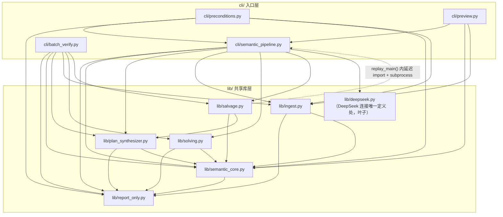

# 阶段二工程结构

## 目录总览

```text
tools/report_constraints_v2/
├── README.md                 # 操作说明（唯一入口是仓库根目录的 main.py）
├── STRUCTURE.md              # 本结构说明
├── MIGRATION.md              # 目录迁移历史与旧路径映射
├── cli/                      # 入口层：main.py 实际调用的可执行脚本
│   ├── __init__.py
│   ├── semantic_pipeline.py  # run：单案例端到端
│   ├── batch_verify.py       # batch / verify
│   ├── preview.py            # screen / preview-*
│   └── preconditions.py      # audit-preconditions / repair-preconditions
├── lib/                      # 共享库层：被 import，不通过 main.py 暴露新命令
│   ├── __init__.py
│   ├── semantic_core.py      # P/I/V schema、类型、编译、基础校验
│   ├── plan_synthesizer.py   # 形式计划校验与确定性公式合成
│   ├── deepseek.py           # DeepSeek 连接唯一定义处：配置/密钥/代理/HTTP 传输
│   ├── report_only.py        # 报告解析、表达式编译、DeepSeek 传输
│   ├── ingest.py             # evidence_catalog + report_readiness 合并
│   ├── solving.py            # symbolic_queries + review 合并
│   ├── salvage.py            # fidelity + mechanical_salvage 合并
│   ├── stage3_consistency.py # stage3-feedback：阶段三绑定反馈与真实一致性判定
│   └── compat.py             # 历史模块名兼容注册（16 个名字，见下）
├── prompts/                  # Prompt 注册表与冻结版本
│   ├── definitions.py        # P/I/V 集中式语义定义
│   ├── active.py             # 生产 Prompt 显式解析与哈希
│   ├── registry.py
│   └── versions/
├── tests/                    # 全部自动测试
├── docs/                     # 设计、状态和历史说明
├── evaluation/               # 冻结评测与运行报告
├── results/                  # 本地运行产物
├── samples/                  # 本地固定样例
└── review_samples/           # 人工审核材料
```

## 三层结构

| 层 | 目录 | 内容 | 规则 |
| --- | --- | --- | --- |
| 入口层 | `cli/` | 4 个脚本 | 可被 `main.py` 直接调用的脚本放这里；**不要直接 `python cli/x.py`** |
| 共享库层 | `lib/` | 8 个模块 | 无命令入口，只被 import |
| 兼容层 | `lib/compat.py` | 16 个名字的映射表 | 不是目录层；只做名字解析，不含任何业务逻辑 |

阶段二根目录**不含任何 `.py`**：实现全部在 `lib/` 或 `cli/`，旧名字的兼容由
`lib/compat.py` 集中承担。

### 为什么 `cli/x.py` 不能直接运行

`python cli/x.py` 会让 Python 把 `cli/` 当作 `sys.path[0]`，于是脚本里的
裸名 import（`from fidelity import ...`）会失败：

```text
ModuleNotFoundError: No module named 'prompts'
```

这是刻意的边界，不是缺陷——4 个 `cli/` 文件行为一致。正确入口：

- `python main.py <command>`（`main.py` 会把 `cli/`、`lib/`、阶段二根目录一起加入 `sys.path`）
- 或 `python -m cli.<script>` / `python -m lib.<script>`，且 **cwd 为阶段二目录**

同样的原因，任何脚本用 `subprocess` 调另一脚本时，**用 `-m` + `cwd=阶段二目录`，
不要直接指向 `cli/` 里的文件**：

```python
subprocess.run([sys.executable, '-m', 'cli.semantic_pipeline', *args],
               cwd=str(STAGE2_ROOT))
```

`-m` 会把 cwd 放进子进程的 `sys.path[0]`，于是 `cli` 与 `lib` 两个包都可 import，
`cli/__init__.py` 也顺带完成兼容注册。3 处调用点：`cli/batch_verify.py`、
`lib/salvage.py` 的 `replay_main()`、`evaluation/gold_v1/run_blind.py`。

## 唯一入口

对外的唯一入口是仓库根目录的 `main.py`：

当前完整依赖环境位于 `/root/.local/share/uv/tools/halmos/bin/python`；系统 Python
没有 Z3。下列 `python` 表示已激活等价环境，未激活时请换成该完整路径。

```bash
cd /root/sc_slicer_standalone
python main.py <command> [参数...]           # 阶段二 / 工程命令
python main.py test | versions | doctor | status | frozen
```

`main.py` 只做分发：参数原样转发给对应脚本，子进程退出码原样返回。不要在
`main.py` 里实现阶段逻辑，也不要在阶段二根目录新增实现文件。

命令表在 `main.py` 顶部，是权威清单：

| 表 | 条数 | 说明 |
| --- | ---: | --- |
| `META_COMMANDS` | 5 | 工程命令：`test` / `versions` / `doctor` / `status` / `frozen` |
| `STAGE2_COMMANDS` | 12 | 映射到 `cli/` 或 `lib/` 中的 5 个脚本 |
| `LIBRARY_MODULES` | 3 | 纯库模块：`semantic_core.py` / `plan_synthesizer.py` / `ingest.py` |

脚本解析顺序为 `cli/` → `lib/` → 阶段二根目录，由 `main.py` 的
`STAGE2_SCRIPT_DIRS` 定义。

`main.py` 还会注入默认值（`STAGE2_ARG_DEFAULTS` 一张表统一描述，且**只在调用者
没有自己指定时**生效）：

| 注入 | 命令 | 生效条件 |
| --- | --- | --- |
| 前置 `--provider deepseek [--model deepseek-flash]` | `run` / `batch` | `run` 仅当带 `--extract` 或 `--formalize-only`（离线重放不注入）；`batch` 恒生效 |
| 追加 `--claim-verdict signals` | `run` / `batch` | 恒生效（见"断言策略"一节） |
| 追加 `--deepseek-proxy direct` | `run` / `batch` | 恒生效；仅对 `--provider deepseek` 有意义 |
| 追加 `--formal-retries 1` | `run` | 带任一神经标志（`--extract` / `--formalize-only`），与目标脚本 parser 守卫对齐 |
| 追加 `--element-retries 1` | `run` | 仅 `--extract`（parser 要求 element 重试必须有提取） |

`--deepseek-proxy direct` 注入的原因：官方传输原本**隐式**继承
`*_proxy` 环境变量，而 `HTTPS_PROXY` 指向不响应 HTTP CONNECT 的端口时，失败信息只有
`DeepSeek network failure; details not saved`，排查代价很高。需要代理时显式传
`--deepseek-proxy environment` 或一个 `http(s)://` URL。`opencode` 通道不读这个标志。

`run` 之所以区分神经/离线：离线 run 只是重放已保存的 candidate，而 DeepSeek
传输会直接拒绝非神经调用，无条件注入会让每一次离线 `main.py run` 退出码 2。
重试预算注入的原因：直跑 `run` 的 argparse 默认是 0（离线 run 注入非零会触发
parser 错误），而 `batch` 一直转发 1——两个入口行为不一致，2026-10-13 冒烟
实测暴露（同一报告 batch 预算下经 field-scoped 修复转为候选，直跑把可修复
错误当终局）。

## 命令到脚本的映射

| 命令 | 脚本 | 前导参数 |
| --- | --- | --- |
| `run` | `cli/semantic_pipeline.py` | — |
| `batch` | `cli/batch_verify.py` | — |
| `verify` | `cli/batch_verify.py` | `verify` |
| `screen` | `cli/preview.py` | `screen` |
| `preview-report` | `cli/preview.py` | `report` |
| `preview-plan` | `cli/preview.py` | `plan` |
| `preview-prompt` | `cli/preview.py` | `prompt` |
| `audit-preconditions` | `cli/preconditions.py` | `audit` |
| `repair-preconditions` | `cli/preconditions.py` | `repair` |
| `observability` | `lib/solving.py` | — |
| `salvage-replay` | `lib/salvage.py` | — |
| `stage3-feedback` | `lib/stage3_consistency.py` | — |

多个命令共用一个脚本时用前导参数区分（`main.py` 的 `STAGE2_ARG_PREFIX`）。
`lib/solving.py` 和 `lib/salvage.py` 既是库、又各带一个 `__main__` 入口，
因此**不列入** `LIBRARY_MODULES`。

## 模块职责

### `cli/` 入口层

| 文件 | 行数 | 作用 |
| --- | ---: | --- |
| `semantic_pipeline.py` | 1096 | 报告筛选、两步模型调用、规则化、Z3 和输出 |
| `batch_verify.py` | 574 | `batch`（限量并发跑真实报告）+ `verify`（零模型调用重放） |
| `preconditions.py` | 362 | 可选 `audit`（P 证据/时序审查）与 `repair`（受约束 P 修复） |
| `preview.py` | 154 | 本地 `screen` 检查与 `report` / `plan` / `prompt` 预览 |

### `lib/` 共享库层

| 文件 | 行数 | 作用 | 由哪些文件合并而来 |
| --- | ---: | --- | --- |
| `semantic_core.py` | 754 | P/I/V schema、类型、编译与基础校验 | — |
| `plan_synthesizer.py` | 998 | 形式计划校验和确定性公式合成（含 semantic-live-5 的重复谓词门与三件 advisory/部分形式化审查） | — |
| `deepseek.py` | 203 | **DeepSeek 连接唯一定义处**：模型白名单与默认模型、官方端点、密钥文件路径、解码参数（temperature 0 / max_tokens 8192）、密钥读取校验、代理三态策略、`extract_deepseek` HTTP 传输 | — |
| `report_only.py` | 432 | 报告解析、表达式编译、opencode 传输（`extract`） | （含原 `review_semantics.py` 的 `relationship_review`） |
| `ingest.py` | 164 | 原文片段编号、ID 回填、提取前信息充分性门 | `evidence_catalog.py` + `report_readiness.py` |
| `solving.py` | 233 | SMT/Z3 查询与 witness 校验、分流与可观察变量审查 | `symbolic_queries.py` + `review.py` |
| `salvage.py` | 543 | 数值与零地址保真守卫（拒绝消息带缺失来源）、机械修复、示例钉死 advisory | `fidelity.py`（原 `numeric_fidelity.py` + `address_fidelity.py`）+ `mechanical_salvage.py` |
| `stage3_consistency.py` | 224 | stage3-binding-contract 生成、阶段三反馈 ingest 与真实 consistency 判定（semantic-live-5） | — |

`deepseek.py` 是唯一不 import 任何同层模块的叶子模块（只依赖标准库）。
DeepSeek 的一切——配置、密钥、代理、传输——都只在它里面；
`report_only.py` 不再持有任何 DeepSeek 代码（回归测试
`DeepSeekSingleSourceTests` 守护这一点），`cli/semantic_pipeline.py`
直接 `from deepseek import ...`。

`report_only.py` 保留少量历史 CLI 兼容代码，但当前职责是报告解析、表达式编译和 DeepSeek 传输库。

### 历史模块名兼容层（`lib/compat.py`）

重构前的 14 个模块名不再对应任何文件，它们由**一个**文件集中接管：
`lib/compat.py` 的 `ALIASES` 表 + 一个 `sys.meta_path` finder。表里还有
两个非历史名字：`stage3_consistency`（semantic-live-5）与
`deepseek`（DeepSeek 连接显性化）——它们早期作为 `cli/` 里的裸名
import 存在，现在同属历史侧。

2026-10-09 收口：`lib/`、`cli/`、`tests/` 的**活跃代码已零裸名 import**
（全部点分路径），本层的受众只剩历史侧——`evaluation/` 冻结批次的内部
脚本（如 `prompt_live1_blind_01/probe_assumption_relief.py`）、归档脚本
与未来对旧 run 的离线重放片段。

| 旧名字 | 现在真正包含该代码的模块 | 来源 |
| --- | --- | --- |
| `evidence_catalog` / `report_readiness` | `lib/ingest.py` | 合并（S5） |
| `review` / `symbolic_queries` | `lib/solving.py` | 合并（S6/S7） |
| `fidelity` / `mechanical_salvage` | `lib/salvage.py` | 合并（S6/S8） |
| `run_semantic_batch` / `verify_semantic` | `cli/batch_verify.py` | 合并（S9） |
| `semantic_core` / `plan_synthesizer` / `report_only` | `lib/` 下的同名文件 | 移动（S2/S3） |
| `semantic_pipeline` / `preview` / `preconditions` | `cli/` 下的同名文件 | 移动（S4） |
| `stage3_consistency` | `lib/stage3_consistency.py` | 新模块的裸名 import（semantic-live-5） |
| `deepseek` | `lib/deepseek.py` | 新模块的裸名 import（DeepSeek 连接显性化） |

16 个名字对应 **12 个**真实模块（合并行共用一个文件）。

#### 注册点（每个进程各一次）

模块名是**按进程**解析的，所以 finder 必须在每个入口进程里注册一次：

| 注册点 | 覆盖 |
| --- | --- |
| `main.py`（`_delegate` 内） | `cli/` 与 `lib/` 的全部命令路径 |
| `tests/__init__.py` | 历史脚本按进程解析的兜底（活跃测试已点分导入） |
| `cli/__init__.py` | `python -m cli.<script>` 子进程（3 处 `subprocess` 都走这条） |
| `lib/__init__.py` | `python -m lib.<script>` |

`python main.py doctor` 有一条专用自检 `历史模块名兼容层(len(ALIASES) 个)`，用来发现
"某个入口忘了注册"。

#### 为什么是延迟解析 + `insert(0)`

finder 只在某个旧名字**真的被 import 时**才加载目标模块，不会在启动时把 16 个模块
（含 z3 与 53KB 的 `semantic_pipeline`）全部拉进来。

`sys.meta_path.insert(0, ...)`（**不能**是 `append`）是必需的：`cli/` 与 `lib/` 都在
`sys.path` 上，若让 PathFinder 先跑，`import report_only` 会把
`lib/report_only.py` 加载成一个名为 `report_only` 的**独立模块**，与
`lib.report_only` 变成两份互不相干的对象（模块级状态会分叉）。插到最前面才能保证
别名就是真模块本身：

```python
sys.modules['fidelity'] is sys.modules['lib.salvage']   # True
```

`_AliasLoader.create_module()` 直接返回目标模块对象，因此 identity 与旧 shim 的
`sys.modules[__name__] = _m` 完全等价：私有名（`_predicate` 等）照常可访问，
`patch.object(report_only, 'extract')` 这类测试也不受影响。

## 断言策略（claim verdict policy）

`lib/semantic_core.py` 的 `compile_bundle()` 是唯一的"这张断言能不能算通过"
判定处。严格度由 `verdict_v2` 形参决定，共两套策略：

| 策略 | 触发方式 | `acceptance_status` 由什么决定 |
| --- | --- | --- |
| `legacy` | 默认值；直接跑 `cli/semantic_pipeline.py` | 结构性原因 **或** 任何模型自报的歧义/局限/未决项 |
| `signals` | `--claim-verdict signals`；`main.py run` / `batch` 自动注入 | 仅结构性原因（公式不可满足、I/V 倒置等） |

`signals` 把"模型自报不确定性"从**否决票**降级为**信息性字段**：

| 原先的否决项 | `signals` 下的去向 |
| --- | --- |
| `elements.ambiguities` | `report_ambiguities_declared` |
| `formalization.limitations` | `formalization_limitations_declared` |
| `claim.unresolved` | 保留在该 claim 的 `unresolved` 字段 |
| `claim.modality != 'asserted'` | 保留在该 claim 的 `modality` 字段 |
| effect coverage 不完整 | `coverage_status` / `coverage_gaps` |
| `report impacts not assigned` | `coverage_gaps` 含 `impacts_not_assigned` |
| `unused preconditions`（仅 `strict_piv`） | `coverage_gaps` 含 `preconditions_not_used` |

设计约束：**`legacy` 必须逐字节不变**。`cli/batch_verify.py` 用
`require(bundle == saved, 'bundle replay mismatch')` 做严格相等重放，
78 份冻结产物与 8 个测试文件依赖旧输出。因此所有新行为都在 `verdict_v2` 之后，
且策略必须写进 `provenance.claim_verdict_policy`，`verify` 才能按原策略重放：

```bash
python main.py verify <run-dir>   # 读 provenance 里的策略，不猜测
```

在 72 个可重算 run 上的实测（零模型调用）：`legacy` 0/72 通过，
`signals` 68/72（94.4%），剩余 4 个均为真实结构/语义问题。

`coverage_status` 描述的是**报告覆盖的完整度**，不是断言的对错
（当前 70/72 为 `partial`，多为 `effect_coverage_partial`）。它与
`acceptance_status` 正交，不要用前者替代后者做放行判断。

## 依赖关系（分层 DAG）

同包内 import 的实际方向如下（`main.py` 额外注入 `sys.path`，不在此图内）：



- 层内无环：运行时用真实 `sys.modules` 对象图检测，**互导入环为 0**。
- `lib/salvage.py → cli/semantic_pipeline.py` 是图中唯一的向上引用，且**只在
  `replay_main()` 运行时发生**（延迟 import 与 `subprocess`），不影响 import
  期的层次关系。若要彻底消除，需把 `load_report` / `write_json` 下移到 `lib/`。

## Prompt 管理原则

- 所有运行时版本从 `prompts/registry.py` 获取；功能开关经
  `feature_enabled(version, feature)` / `features_for(version)` 查询，不在主流程
  重复写版本元组。
- 主流程通过 `prompts/active.py` 解析最终 Prompt，不直接追踪版本继承链。
- P/I/V 的人类可读规范只在 `prompts/definitions.py` 维护。
- **唯一可编辑的 Prompt 是 `prompts/current.py`（`semantic-live`，默认版本），
  原地修改**；功能门翻转在其中的 `FEATURES` 同步声明。
- `prompts/versions/` 是冻结只读存档（v3.5–v3.20），供历史 run 回放；
  不修改、不折叠、不新增。
- 重放契约：neural 运行把 `prompt-element.txt`/`prompt-formal.txt` 快照与
  `prompt_features` 决策写进 run 目录；`verify` 优先回放快照（不读 current.py
  当前内容），无快照的旧 run 回落冻结版本解析。政策全文见
  `docs/PROMPT_LIVE_POLICY.md`。

使用 `python main.py preview-prompt --part definitions|element|formal` 可查看集中定义或
生产流程实际使用的最终文本；该命令不读取 API Key，也不调用模型。

## 冻结资产

阶段一 Rust 源码、`run.sh` 和 v1 ZIP 归档一旦定稿
不得原地改写，否则历史实验无法重放。清单在仓库根目录 `PROTECTED_HASHES.json`：

```bash
python main.py frozen        # 校验，有漂移则退出码 1
python main.py frozen --write  # 确认是预期变更后重新生成
```

覆盖范围见 `main.py` 的 `FROZEN_SCOPES`（21 项）。`.slicer_cache.json` 是可变的运
行缓存，故意不纳入冻结清单。

### 另一套冻结哈希：`evaluation/` 里的 `code_sha256`

`python main.py frozen` **不覆盖**评测清单。`evaluation/` 下的 7 份
`manifest.json` / `SELECTION.json` 各自记录了一组 `code_sha256`，用来证明
"这批结果由哪份实现产出"。

迁移到 `lib/` + `cli/` 后，这些键名已不再指向实现文件（部分模块被合并、原文件名
已不存在）。因此清单读取方按 **"现在真正包含该代码的文件"** 解析名字，
映射表见 `evaluation/fresh_holdout_01/evaluate.py` 的 `CODE_PATHS`：

| 清单里的键 | 现在的文件 |
| --- | --- |
| `semantic_pipeline.py` | `cli/semantic_pipeline.py` |
| `report_only.py` | `lib/report_only.py` |
| `plan_synthesizer.py` | `lib/plan_synthesizer.py` |
| `semantic_core.py` | `lib/semantic_core.py` |
| `evidence_catalog.py` / `report_readiness.py` | `lib/ingest.py`（同一文件，同一哈希） |
| `fidelity.py` / `numeric_fidelity.py` / `address_fidelity.py` | `lib/salvage.py`（同一文件，同一哈希） |
| `review.py` / `symbolic_queries.py` | `lib/solving.py`（同一文件，同一哈希） |
| `semantic_prompts_v3*.py` | `prompts/versions/` 下，未移动 |

校验方式（`main.py frozen` 不会做这件事）：

```bash
cd tools/report_constraints_v2
/root/.local/share/uv/tools/halmos/bin/python evaluation/fresh_holdout_01/evaluate.py
# 关注输出里的 current_code_differs_from_frozen，空列表表示无漂移
```

**注意**：这组哈希已两次重新基线 —— S10 重建了全部 46 个 key（迁移前它
们指向已合并/已删除的文件名），S12 又因 `semantic_core.py` 与
`semantic_pipeline.py` 的改动重设了 10 个 key（7 份清单）。它记录的是
"迁移后的当前实现"，不再等于各次实验当时的历史代码版本
（`semantic_pipeline.py` 曾有 6 个不同版本）。历史版本仅保留在 Git 与
`archives/` 中。重设过程只替换哈希值字符串，不重新序列化 JSON，
以保证 diff 干净。

`prompts/definitions.py` **不在** `CODE_PATHS` 中，因此不受这组哈希约束：
它是人读的规范文本，运行时提示词来自冻结的 `prompts/versions/*`。

## 产物与源码的边界

- `evaluation/`、`results/` 中的 JSON/SMT/响应属于实验产物，不是运行时代码。
- `docs/` 中的历史报告不控制程序行为。
- `tests/` 可以读取冻结产物做重放，但不能覆盖产物。
- `config/stage2_deepseek.local.env` 位于项目根目录且被 Git 忽略，任何阶段二文件都不得保存
  API Key。
