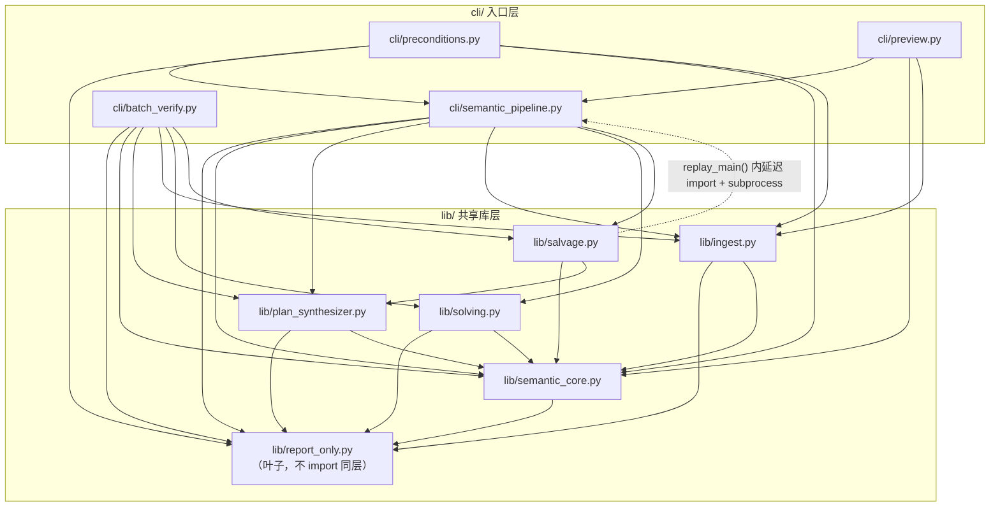

# 阶段二工程结构

## 目录总览

```text
tools/report_constraints_v2/
├── README.md                 # 操作说明（唯一入口是仓库根目录的 main.py）
├── STRUCTURE.md              # 本结构说明
├── MIGRATION.md              # 目录迁移历史与旧路径映射
├── cli/                      # 入口层：main.py 实际调用的可执行脚本
│   ├── __init__.py
│   ├── semantic_pipeline.py  # run：单案例端到端
│   ├── batch_verify.py       # batch / verify
│   ├── preview.py            # screen / preview-*
│   └── preconditions.py      # audit-preconditions / repair-preconditions
├── lib/                      # 共享库层：被 import，不通过 main.py 暴露新命令
│   ├── __init__.py
│   ├── semantic_core.py      # P/I/V schema、类型、编译、基础校验
│   ├── plan_synthesizer.py   # 形式计划校验与确定性公式合成
│   ├── report_only.py        # 报告解析、表达式编译、DeepSeek 传输
│   ├── ingest.py             # evidence_catalog + report_readiness 合并
│   ├── solving.py            # symbolic_queries + review 合并
│   └── salvage.py            # fidelity + mechanical_salvage 合并
├── *.py                      # 14 个兼容 shim（每个 3–4 行，仅做模块别名）
├── prompts/                  # Prompt 注册表与冻结版本
│   ├── definitions.py        # P/I/V 集中式语义定义
│   ├── active.py             # 生产 Prompt 显式解析与哈希
│   ├── registry.py
│   └── versions/
├── tests/                    # 全部自动测试
├── docs/                     # 设计、状态和历史说明
├── evaluation/               # 冻结评测与运行报告
├── results/                  # 本地运行产物
├── samples/                  # 本地固定样例
└── review_samples/           # 人工审核材料
```

## 三层结构

| 层 | 目录 | 内容 | 规则 |
| --- | --- | --- | --- |
| 入口层 | `cli/` | 4 个脚本 | 可被 `main.py` 直接调用的脚本放这里；**不要直接 `python cli/x.py`** |
| 共享库层 | `lib/` | 6 个模块 | 无命令入口，只被 import |
| 兼容层 | 阶段二根目录 | 14 个 shim | 每个 3–4 行，只做 `sys.modules` 别名转发；不含任何业务逻辑 |

阶段二根目录已**不再包含任何实现代码**：14 个 `.py` 全部是别名 shim。
迁移前的实现文件都已在 `lib/` 或 `cli/` 中。

### 为什么 `cli/x.py` 不能直接运行

`python cli/x.py` 会让 Python 把 `cli/` 当作 `sys.path[0]`，于是脚本里的
裸名 import（`from fidelity import ...`）会失败：

```text
ModuleNotFoundError: No module named 'prompts'
```

这是刻意的边界，不是缺陷——4 个 `cli/` 文件行为一致。正确入口：

- `python main.py <command>`（`main.py` 会把 `cli/`、`lib/`、阶段二根目录一起加入 `sys.path`）
- 或运行阶段二根目录下同名的 shim

同样的原因，任何脚本用 `subprocess` 调另一脚本时，**必须指向阶段二根目录的
shim，而不是 `cli/` 里的文件**；否则子进程的 `sys.path[0]` 会变成 `cli/`。
见 `lib/salvage.py` 的 `replay_main()` 与 `cli/batch_verify.py` 的 `HERE`。

## 唯一入口

对外的唯一入口是仓库根目录的 `main.py`：

当前完整依赖环境位于 `/root/.local/share/uv/tools/halmos/bin/python`；系统 Python
没有 Z3。下列 `python` 表示已激活等价环境，未激活时请换成该完整路径。

```bash
cd /root/sc_slicer_standalone
python main.py <command> [参数...]           # 阶段二 / 工程命令
python main.py test | versions | doctor | status | frozen
```

`main.py` 只做分发：参数原样转发给对应脚本，子进程退出码原样返回。不要在
`main.py` 里实现阶段逻辑，也不要在阶段二根目录新增实现文件。

命令表在 `main.py` 顶部，是权威清单：

| 表 | 条数 | 说明 |
| --- | ---: | --- |
| `META_COMMANDS` | 5 | 工程命令：`test` / `versions` / `doctor` / `status` / `frozen` |
| `STAGE2_COMMANDS` | 11 | 映射到 `cli/` 或 `lib/` 中的 4 个脚本 |
| `LIBRARY_MODULES` | 3 | 纯库模块：`semantic_core.py` / `plan_synthesizer.py` / `ingest.py` |

脚本解析顺序为 `cli/` → `lib/` → 阶段二根目录，由 `main.py` 的
`STAGE2_SCRIPT_DIRS` 定义。

## 命令到脚本的映射

| 命令 | 脚本 | 前导参数 |
| --- | --- | --- |
| `run` | `cli/semantic_pipeline.py` | — |
| `batch` | `cli/batch_verify.py` | — |
| `verify` | `cli/batch_verify.py` | `verify` |
| `screen` | `cli/preview.py` | `screen` |
| `preview-report` | `cli/preview.py` | `report` |
| `preview-plan` | `cli/preview.py` | `plan` |
| `preview-prompt` | `cli/preview.py` | `prompt` |
| `audit-preconditions` | `cli/preconditions.py` | `audit` |
| `repair-preconditions` | `cli/preconditions.py` | `repair` |
| `observability` | `lib/solving.py` | — |
| `salvage-replay` | `lib/salvage.py` | — |

多个命令共用一个脚本时用前导参数区分（`main.py` 的 `STAGE2_ARG_PREFIX`）。
`lib/solving.py` 和 `lib/salvage.py` 既是库、又各带一个 `__main__` 入口，
因此**不列入** `LIBRARY_MODULES`。

## 模块职责

### `cli/` 入口层

| 文件 | 行数 | 作用 |
| --- | ---: | --- |
| `semantic_pipeline.py` | 865 | 报告筛选、两步模型调用、规则化、Z3 和输出 |
| `batch_verify.py` | 330 | `batch`（限量并发跑真实报告）+ `verify`（零模型调用重放） |
| `preconditions.py` | 368 | 可选 `audit`（P 证据/时序审查）与 `repair`（受约束 P 修复） |
| `preview.py` | 154 | 本地 `screen` 检查与 `report` / `plan` / `prompt` 预览 |

### `lib/` 共享库层

| 文件 | 行数 | 作用 | 由哪些文件合并而来 |
| --- | ---: | --- | --- |
| `semantic_core.py` | 223 | P/I/V schema、类型、编译与基础校验 | — |
| `plan_synthesizer.py` | 782 | 形式计划校验和确定性公式合成 | — |
| `report_only.py` | 532 | 报告解析、表达式编译、DeepSeek 传输 | （含原 `review_semantics.py` 的 `relationship_review`） |
| `ingest.py` | 164 | 原文片段编号、ID 回填、提取前信息充分性门 | `evidence_catalog.py` + `report_readiness.py` |
| `solving.py` | 226 | SMT/Z3 查询与 witness 校验、分流与可观察变量审查 | `symbolic_queries.py` + `review.py` |
| `salvage.py` | 385 | 数值与零地址保真守卫、机械修复 | `fidelity.py`（原 `numeric_fidelity.py` + `address_fidelity.py`）+ `mechanical_salvage.py` |

`report_only.py` 是唯一不 import 任何同层模块的叶子模块。
它保留少量历史 CLI 兼容代码，但当前职责是报告解析、表达式编译和 DeepSeek 传输库。

### 阶段二根目录：兼容 shim

14 个文件，每个 3–4 行，全部形如：

```python
"""Compat 别名：实现已迁至 lib/xxx.py（S<n>）。本文件仅做模块别名与 CLI 转发。"""
import sys, lib.xxx as _m
sys.modules[__name__] = _m
if __name__ == '__main__': raise SystemExit(_m.main())   # 仅当原文件有 __main__
```

| shim（根目录） | 指向 | 有 `__main__` |
| --- | --- | --- |
| `semantic_core.py` | `lib/semantic_core.py` | 否 |
| `plan_synthesizer.py` | `lib/plan_synthesizer.py` | 否 |
| `report_only.py` | `lib/report_only.py` | 否 |
| `evidence_catalog.py` | `lib/ingest.py` | 否 |
| `report_readiness.py` | `lib/ingest.py` | 否 |
| `review.py` | `lib/solving.py` | 否 |
| `symbolic_queries.py` | `lib/solving.py` | 否 |
| `fidelity.py` | `lib/salvage.py` | 否 |
| `mechanical_salvage.py` | `lib/salvage.py` | 是 |
| `semantic_pipeline.py` | `cli/semantic_pipeline.py` | 是 |
| `preview.py` | `cli/preview.py` | 是 |
| `preconditions.py` | `cli/preconditions.py` | 是 |
| `run_semantic_batch.py` | `cli/batch_verify.py` | 是（`main()`） |
| `verify_semantic.py` | `cli/batch_verify.py` | 是（`verify_main()`） |

### shim 的 `sys.modules` 别名机制

shim 不是"再导出一遍"，而是**把自己替换成真正的模块对象**：

```python
sys.modules[__name__] = _m
```

因此 `import semantic_core` 拿到的对象与 `lib.semantic_core` **是同一个对象**
（`semantic_core is lib.semantic_core` 为真，`__name__` 为 `lib.semantic_core`）。
这带来三点必须知道的性质：

1. **私有名也能访问。** `from plan_synthesizer import _predicate` 可以正常工作；
   若改用 `from plan_synthesizer import *` 写 shim，`_` 开头名字不会导出。
2. **`from semantic_core import *` 在 shim 里是自引用**，会静默得到空模块。
   所以本目录的 shim 一律用 `sys.modules` 别名写法。
3. **`__main__` 转发是必需的。** 没有那行时，`python semantic_pipeline.py`
   会导入真文件（不是 `__main__`），原文件的 `if __name__ == '__main__'` 为
   False，于是**静默退出 0**、什么都不做。这类错误没有测试能发现。

因为 shim 与真模块是同一对象，`evidence_catalog is report_readiness` 为真
（两者都指向 `lib/ingest.py`）；`fidelity`/`mechanical_salvage` 指向
`lib/salvage.py`；`review`/`symbolic_queries` 指向 `lib/solving.py`。

## 依赖关系（分层 DAG）

同包内 import 的实际方向如下（`main.py` 额外注入 `sys.path`，不在此图内）：



- 层内无环：运行时用真实 `sys.modules` 对象图检测，**互导入环为 0**。
- `lib/salvage.py → cli/semantic_pipeline.py` 是图中唯一的向上引用，且**只在
  `replay_main()` 运行时发生**（延迟 import 与 `subprocess`），不影响 import
  期的层次关系。若要彻底消除，需把 `load_report` / `write_json` 下移到 `lib/`。

## Prompt 管理原则

- 所有运行时版本从 `prompts/registry.py` 获取。
- 主流程通过 `prompts/active.py` 解析最终 Prompt，不直接追踪版本继承链。
- P/I/V 的人类可读规范只在 `prompts/definitions.py` 维护。
- `prompts/versions/` 中每个文件对应一个冻结实验版本，内容不可原地改写。
- 功能开关集中在注册表，不在主流程重复写版本元组。
- 新版本新增文件；不要复制一套新的 pipeline。

使用 `python main.py preview-prompt --part definitions|element|formal` 可查看集中定义或
生产流程实际使用的最终文本；该命令不读取 API Key，也不调用模型。

## 冻结资产

阶段一 Rust 源码、`run.sh` 和 v1 ZIP 归档一旦定稿
不得原地改写，否则历史实验无法重放。清单在仓库根目录 `PROTECTED_HASHES.json`：

```bash
python main.py frozen        # 校验，有漂移则退出码 1
python main.py frozen --write  # 确认是预期变更后重新生成
```

覆盖范围见 `main.py` 的 `FROZEN_SCOPES`（21 项）。`.slicer_cache.json` 是可变的运
行缓存，故意不纳入冻结清单。

### 另一套冻结哈希：`evaluation/` 里的 `code_sha256`

`python main.py frozen` **不覆盖**评测清单。`evaluation/` 下的 7 份
`manifest.json` / `SELECTION.json` 各自记录了一组 `code_sha256`，用来证明
"这批结果由哪份实现产出"。

迁移到 `lib/` + `cli/` 后，这些键名已不再指向实现文件（部分模块被合并、
原文件名只剩 shim）。因此清单读取方按 **"现在真正包含该代码的文件"** 解析名字，
映射表见 `evaluation/fresh_holdout_01/evaluate.py` 的 `CODE_PATHS`：

| 清单里的键 | 现在的文件 |
| --- | --- |
| `semantic_pipeline.py` | `cli/semantic_pipeline.py` |
| `report_only.py` | `lib/report_only.py` |
| `plan_synthesizer.py` | `lib/plan_synthesizer.py` |
| `semantic_core.py` | `lib/semantic_core.py` |
| `evidence_catalog.py` / `report_readiness.py` | `lib/ingest.py`（同一文件，同一哈希） |
| `fidelity.py` / `numeric_fidelity.py` / `address_fidelity.py` | `lib/salvage.py`（同一文件，同一哈希） |
| `review.py` / `symbolic_queries.py` | `lib/solving.py`（同一文件，同一哈希） |
| `semantic_prompts_v3*.py` | `prompts/versions/` 下，未移动 |

校验方式（`main.py frozen` 不会做这件事）：

```bash
cd tools/report_constraints_v2
/root/.local/share/uv/tools/halmos/bin/python evaluation/fresh_holdout_01/evaluate.py
# 关注输出里的 current_code_differs_from_frozen，空列表表示无漂移
```

**注意**：这组哈希在 S10 已重新基线，记录的是"迁移后的当前实现"，不再等于
各次实验当时的历史代码版本（`semantic_pipeline.py` 曾有 6 个不同版本）。
历史版本仅保留在 Git 与 `archives/` 中。

## 产物与源码的边界

- `evaluation/`、`results/` 中的 JSON/SMT/响应属于实验产物，不是运行时代码。
- `docs/` 中的历史报告不控制程序行为。
- `tests/` 可以读取冻结产物做重放，但不能覆盖产物。
- `config/stage2_deepseek.local.env` 位于项目根目录且被 Git 忽略，任何阶段二文件都不得保存
  API Key。
