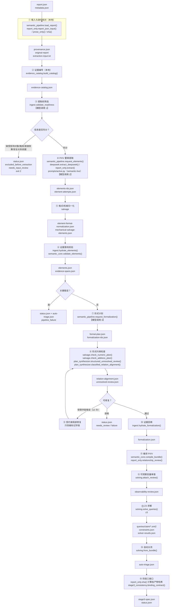
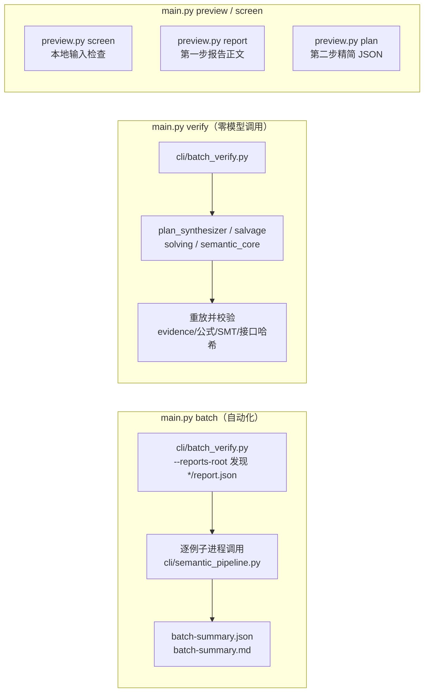

# 阶段二流程图与文件索引

来源：直接读 `cli/semantic_pipeline.py` 主流程代码，非文档转述。更新于 2026-10-12
（S1–S12 目录收口 + 新 SC 工作废弃后）。

本文档止于阶段二主链（报告 → P/I/V → stage3-spec）。阶段三把代码执行关系 T 与本阶段输出绑定后判断一致性（`main.py stage3-feedback`，`lib/stage3_consistency.py`）。

## 1. 主流程 `python main.py run`

## 2. 每一步的文件与产物

| # | 步骤 | 调用文件（函数） | 产物 | 模型调用 |
|---|---|---|---|---|
| ① | 载入与身份核对 | `cli/semantic_pipeline.py` `load_report()` → `lib/report_only.py` `report_json_input()` / `prose_only()` / `sha()` | `provenance.json`、`original-report`、`extraction-input.txt` | 否 |
| ② | 证据编号 | `lib/ingest.py` `build_catalog()` | `evidence-catalog.json` | 否 |
| ③ | 提取前筛选 | `cli/semantic_pipeline.py` `request_readiness()`；Prompt 来自 `prompts/active.py` | `neural-input-screen/prompt.txt`、`input-readiness.json` | **1 次** |
| ④ | P/I/V 要素提取 | `cli/semantic_pipeline.py` `request_elements()` → `lib/deepseek.py` `extract_deepseek()`（或 `lib/report_only.py` `extract()`）；Prompt 来自 `prompts/active.py` | `elements-ids.json`、`element-attempts.json` | **1 次**（可重试 1 次） |
| ⑤ | 格式/机械归一化 | `lib/salvage.py` `normalize_element_ids()` / `normalize_attack_step_roles()` / `drop_unused_invalid_symbols()` | `element-format-normalization.json`、`mechanical-salvage-elements.json` | 否 |
| ⑥ | 证据落地校验 | `lib/ingest.py` `hydrate_elements()`、`lib/semantic_core.py` `validate_elements()` | `elements.json`、`evidence-spans.json` | 否 |
| ⑦ | 形式计划 | `cli/semantic_pipeline.py` `request_formalization()` → `lib/deepseek.py` `extract_deepseek()` | `formal-plan.json`、`formalization-ids.json` | **1 次**（可重试 2 次） |
| ⑧ | 形式约束检查 | `lib/salvage.py` `check_numeric_plan()` / `check_address_plan()`；`lib/plan_synthesizer.py` `structured_unresolved_review()` / `classified_relation_alignment()` | `relation-alignment.json`、`unresolved-review.json` | 否 |
| ⑨ | 受约束局部修复 | `cli/semantic_pipeline.py` `formal_repair_fields()` / `local_repair_payload()`（≤2 次，**会再调模型**） | 追加到 `formalization-attempts.json` | 每次 1 次 |
| ⑩ | 证据回填 | `lib/ingest.py` `hydrate_formalization()` | `formalization.json` | 否 |
| ⑪ | 编译 P/I/V | `lib/semantic_core.py` `compile_bundle()` → `lib/report_only.py` `relationship_review()` | （内存 bundle） | 否 |
| ⑫ | 可观察变量审查 | `lib/solving.py` `attach_review()` | `observability-review.json` | 否 |
| ⑬ | Z3 求解 | `lib/solving.py` `solve_queries()`（`z3`） | `queries/<claim>/*.smt2`、`constraints.json`、`solver-results.json` | 否 |
| ⑭ | 自动分流 | `lib/solving.py` `from_bundle()` / `from_failure()` | `auto-triage.json` | 否 |
| ⑮ | 阶段三接口 | `lib/report_only.py` `sha()`；`lib/stage3_consistency.py` `binding_contract()` | `stage3-spec.json`、`status.json` | 否 |

一次成功的 run 通常是 **3 次模型调用**；被筛选拦掉时只有 1 次。

## 3. 检查门一览

| 门 | 位置 | 判断内容 | 不通过的表现 |
|---|---|---|---|
| 输入充分性门 | `lib/ingest.py` `validate_readiness()` | 受影响对象、触发/行为、直接效果、安全关系依据 | `excluded_before_extraction` / `needs_input_review`，exit 2 |
| 证据编号门 | `lib/ingest.py` `hydrate_elements()` | 未知证据 ID、来源角色 | 拒绝 |
| schema/类型门 | `lib/semantic_core.py` `validate_elements()` / `validate_formalization()` | kind、modality、角色隔离、字段集 | 拒绝 |
| 角色隔离门 | `lib/semantic_core.py:130-142` | P←precondition/assumption，I←security_intent，V←impact | `property source role mismatch` |
| 数值保真门 | `lib/salvage.py` `check_numeric_plan()` | 显式阈值不得退化成布尔量；协议编号不算数值 | 拒绝 |
| 地址保真门 | `lib/salvage.py` `check_address_plan()` | `address(0)` 相关性质须落到地址相等约束 | 拒绝 |
| 关系对齐门 | `lib/plan_synthesizer.py` `classified_relation_alignment()` | 关系类别 ↔ 模板兼容 | 拒绝 |
| P 来源本地化 | `lib/plan_synthesizer.py`（EXPANDED_PLAN_VERSION） | 每条 P 的符号须由该条 P 自己的来源支撑；不同来源不得复用同一谓词 | 拒绝 |
| Z3 门 | `lib/solving.py` `solve_queries()` | `P∧V` 可满足、`P∧V∧I` 不可满足等 | 只证明**生成公式内部**关系 |

注意：Z3 通过不等于报告语义正确，也不等于 PoC 与报告一致。`needs_review` 不是通过。

## 4. 其它命令

| 命令 | 入口文件 | 依赖文件 | 产物 |
|---|---|---|---|
| `batch` | `cli/batch_verify.py` | `cli/semantic_pipeline.py`（子进程）、`prompts/registry.py` | `batch-summary.json`、`batch-summary.md`、每例一个子目录 |
| `verify` | `cli/batch_verify.py` | `lib/report_only`、`lib/semantic_core`、`lib/plan_synthesizer`、`lib/salvage`、`lib/ingest`、`lib/solving`、`prompts` | 控制台 JSON（`offline_verified`） |
| `screen` | `cli/preview.py`（`screen`） | `lib/ingest`、`cli/semantic_pipeline.load_report` | 可选 `--output` JSON |
| `preview-report` / `preview-plan` | `cli/preview.py`（`report` / `plan`） | `lib/ingest`、`lib/semantic_core`、`cli/semantic_pipeline` | 仅标准输出（不写文件） |
| `audit-preconditions` / `repair-preconditions` | `cli/preconditions.py`（`audit` / `repair`） | `lib/report_only`、`lib/ingest`、`lib/semantic_core`、`cli/semantic_pipeline` | 审计/修复 JSON（**主流程不调用，opt-in**） |
| `observability` | `lib/solving.py`（CLI） | 自身 | 审查提示 |
| `salvage-replay` | `lib/salvage.py`（CLI） | `lib/semantic_core`、`lib/plan_synthesizer`、`cli/semantic_pipeline`（延迟导入） | 重放结果目录 |
| `stage3-feedback` | `lib/stage3_consistency.py`（CLI） | 自身 | 该 run 的 `stage3-consistency.json` |

## 5. 模块清单

| 类别 | 文件 |
| --- | --- |
| 入口(4) | `cli/semantic_pipeline.py`、`cli/batch_verify.py`、`cli/preview.py`、`cli/preconditions.py` |
| 库(9) | `lib/semantic_core.py`、`lib/plan_synthesizer.py`、`lib/deepseek.py`、`lib/report_only.py`、`lib/ingest.py`、`lib/solving.py`、`lib/salvage.py`、`lib/stage3_consistency.py`、`lib/compat.py`（历史名兼容） |

Prompt：可编辑的只有 `prompts/current.py`（`semantic-live`，默认版本）；
`prompts/versions/` 是冻结只读存档（v3.5–v3.20，共 16 个）。运行时经
`prompts/active.py` 解析，`prompts/registry.py` 管版本与功能开关。
推荐稳定版 `semantic-v3.16`（冻结）。
