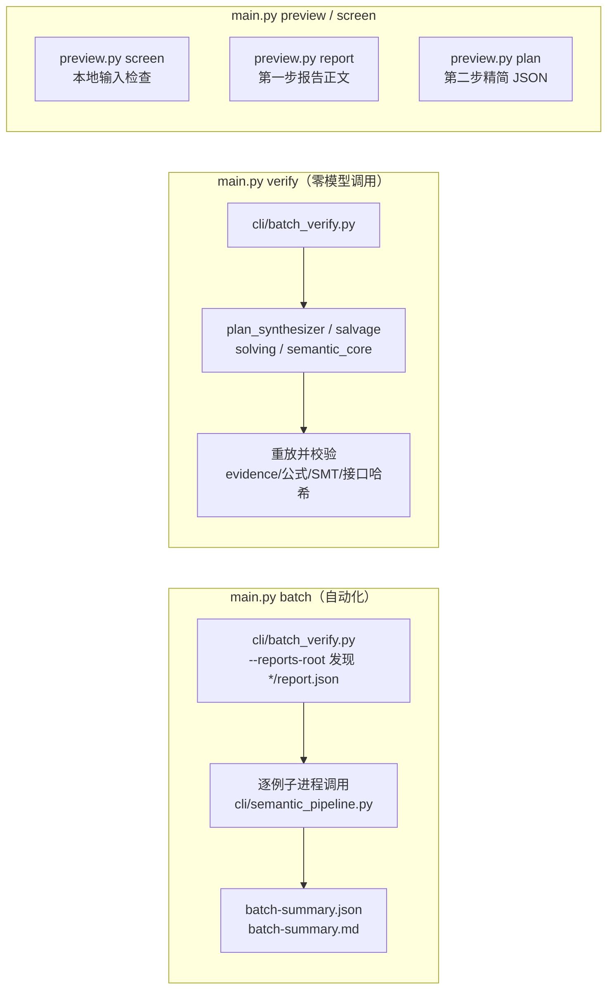

# 阶段二流程图与文件索引

来源：直接读 `cli/semantic_pipeline.py` 主流程代码，非文档转述。更新于 2026-10-23
（semantic-live-24 引入生成器 relationship-trace 及追加式 trace 的机械容错后）。

当前活动版本 semantic-live-24 将已提取 action/root-cause 引用的精确报告片段作为关系上下文传给规则生成器及生成后审查，并要求生成器随形式计划返回仅供审查的 `relationship_trace`（在冻结 relation_context 中引用一条 P/I/V 关系路径）。trace 在合成前剥离，不能成为规则条件或新来源；审查把它当未验证指针独立核对。生成器把 trace 追加在 plan 闭括号之外的同构畸形响应由 `merge_appended_relationship_trace` 确定性容错（v3.20 规范化契约：原始响应不改写、`response-normalization.json` 记录变换、`verify` 重放复验）。上下文只用于理解冻结 P/I/V 的关系，不得新增或改写来源。关系存疑单列为 needs_review；只有 P/I/V 来源公式失配会触发局部修复。仅 passed 来源组进入阶段三。

本文档止于阶段二主链（报告 → P/I/V → stage3-spec）。Impact 只从明确标注的 Impact 区域提取主要、不同且有原文依据的结果；P/I 证据可来自报告正文、明确的 NatSpec/标准要求或直接说明预期安全关系的修复建议。修复动作本身和 Impact 后果不能用来推测 I。阶段三把代码执行关系 T 与本阶段输出绑定后判断一致性（`main.py stage3-feedback`，`lib/stage3_consistency.py`）。

## 1. 主流程 `python main.py run`

```mermaid
flowchart TD
    R["report.json<br/>metadata.json"] --> S1

    subgraph L1["① 载入与身份核对（本地）"]
        S1["semantic_pipeline.load_report()<br/>report_only.report_json_input() / prose_only() / sha()"]
    end
    S1 --> A1["provenance.json<br/>original-report<br/>extraction-input.txt"]

    A1 --> S2["② 证据编号（本地）<br/>evidence_catalog.build_catalog()"]
    S2 --> A2["evidence-catalog.json"]

    A2 --> S3["③ 提取前筛选<br/>ingest.validate_readiness<br/>【模型调用 1】"]
    S3 --> G1{"信息是否充分？"}
    G1 -->|"缺受影响对象/触发/直接效果/安全关系依据"| F1["status.json<br/>excluded_before_extraction<br/>needs_input_review<br/>exit 2"]
    G1 -->|充分| S4

    S4["④ P/I/V 要素提取<br/>semantic_pipeline.request_elements()<br/>deepseek.extract_deepseek() / report_only.extract()<br/>prompts/active.py（semantic-live）<br/>【模型调用 2】"] --> A4["elements-ids.json<br/>element-attempts.json"]
    A4 --> S5["⑤ 格式/机械归一化<br/>salvage"]
    S5 --> A5["element-format-normalization.json<br/>mechanical-salvage-elements.json"]
    A5 --> S6["⑥ 证据落地校验<br/>ingest.hydrate_elements()<br/>semantic_core.validate_elements()"]
    S6 --> A6["elements.json<br/>evidence-spans.json"]
    A6 --> G2{"关键错误？"}
    G2 -->|是| F2["status.json + auto-triage.json<br/>pipeline_failure"]
    G2 -->|否| C0["⑦ 报告级适用性判定<br/>每个 Impact 选择显式 P/I ID 或待复核"]
    C0 --> C1["逐 Impact 建立 semantic-card.json<br/>只含选中的 P/I 来源与证据"]

    C1 --> C2{"适用性已选定？"}
    C2 -->|否| F0["保留 explicit_but_insufficient / needs_review<br/>跳过公式调用"]
    C2 -->|是| S7["⑧ 对每个已选 I 来源独立生成形式计划<br/>一条 (Impact, I) 对一条规则<br/>【逐对模型调用】"]
    S7 --> A7["形式计划生成<br/>每个已冻结来源对一份"]
    A7 --> S8["必要的 schema / 引用 / 类型校验<br/>确定性合成正式规则"]
    S8 --> G3{"可构造正式规则？"}
    G3 -->|"否：结构无法编译"| F3["保留原始响应与失败原因"]
    G3 -->|是| S9["⑨ 规则生成后 P/I/V 忠实度审查<br/>每个冻结来源都覆盖"]
    S9 --> A9["一次生成后审查<br/>来源转写 + P/I/V 关系分项判定"]
    A9 --> G4{"通过状态"}
    G4 -->|"passed"| S10
    G4 -->|"needs_review / failed / unavailable"| F4["候选留档<br/>不交阶段三"]
    S10["⑩ 证据回填<br/>ingest.hydrate_formalization()"]
    S10 --> A10["formalization.json"]
    A10 --> S11["⑪ 编译 P/I/V<br/>semantic_core.compile_bundle()<br/>跳过可行性 / 关系门"]
    S11 --> S12["⑫ 可观察变量审查<br/>solving.attach_review()"]
    S12 --> A12["observability-review.json"]
    A12 --> S13["⑬ Z3 求解<br/>solving.solve_queries()<br/>z3"]
    S13 --> A13["queries/claim/*.smt2<br/>constraints.json<br/>solver-results.json"]
    A13 --> S14["⑭ 自动分流<br/>solving.from_bundle()"]
    S14 --> A14["auto-triage.json"]
    A14 --> S15["⑮ 阶段三接口<br/>report_only.sha() 计算各产物哈希<br/>stage3_consistency.binding_contract()"]
    S15 --> A15["stage3-spec.json<br/>status.json"]
```

## 2. 每一步的文件与产物

| # | 步骤 | 调用文件（函数） | 产物 | 模型调用 |
|---|---|---|---|---|
| ① | 载入与身份核对 | `cli/semantic_pipeline.py` `load_report()` → `lib/report_only.py` `report_json_input()` / `prose_only()` / `sha()` | `provenance.json`、`original-report`、`extraction-input.txt` | 否 |
| ② | 证据编号 | `lib/ingest.py` `build_catalog()` | `evidence-catalog.json` | 否 |
| ③ | 提取前筛选 | `cli/semantic_pipeline.py` `request_readiness()`；Prompt 来自 `prompts/active.py` | `neural-input-screen/prompt.txt`、`input-readiness.json` | **1 次** |
| ④ | P/I/V 要素提取 | `cli/semantic_pipeline.py` `request_elements()` → `lib/deepseek.py` `extract_deepseek()`（或 `lib/report_only.py` `extract()`）；Prompt 来自 `prompts/active.py` | `elements-ids.json`、`element-attempts.json` | **1 次**（可重试 1 次） |
| ⑤ | 格式/机械归一化 | `lib/salvage.py` `normalize_element_ids()` / `normalize_attack_step_roles()` / `drop_unused_invalid_symbols()` | `element-format-normalization.json`、`mechanical-salvage-elements.json` | 否 |
| ⑥ | 证据落地校验 | `lib/ingest.py` `hydrate_elements()`、`lib/semantic_core.py` `validate_elements()` | `elements.json`、`evidence-spans.json` | 否 |
| ⑦ | 报告级 P/I 适用性判定 | `cli/semantic_pipeline.py` `request_impact_applicability()`；`lib/impact_cards.py` `validate_applicability()` | `impact-applicability.json`、prompt/响应/attempts | 有明确 I 候选时 1 次（至多 1 次 schema 重试） |
| ⑧a | 逐 Impact 来源卡与请求范围收窄 | `lib/impact_cards.py` `build_impact_card()` / `target_formal_input()` | `impact-formalizations/<id>/semantic-card.json` | 否 |
| ⑧b | 逐 `(Impact, I)` 独立形式计划 | `cli/semantic_pipeline.py` `request_formalization()` → `lib/deepseek.py` `extract_deepseek()` | 来源对计划和状态、合并后的 `formal-plan.json` / `formalization-ids.json` | 每对 1 次（按配置有限重试；最多 64 对） |
| ⑧ | 结构校验与规则合成 | `lib/plan_synthesizer.py` `synthesize_id_formalization()` | `generated-rule-candidate.json`、`formalization-ids.json` | 否 |
| ⑨ | 生成后忠实度审查 | `cli/semantic_pipeline.py` `request_faithfulness_audit()` | `semantic-faithfulness-audit.json`、`fidelity_status` | 每条规则 1 次（至多 1 次格式重试） |
| ⑩ | 编译 P/I/V | `lib/semantic_core.py` `compile_bundle()`；跳过规则可行性与单位门 | （内存 bundle） | 否 |
| ⑪ | 可观察变量审查 | `lib/solving.py` `attach_review()` | `observability-review.json` | 否 |
| ⑬ | Z3 求解 | `lib/solving.py` `solve_queries()`（`z3`） | `queries/<claim>/*.smt2`、`constraints.json`、`solver-results.json` | 否 |
| ⑭ | 自动分流 | `lib/solving.py` `from_bundle()` / `from_failure()` | `auto-triage.json` | 否 |
| ⑮ | 阶段三接口 | `lib/report_only.py` `sha()`；`lib/stage3_consistency.py` `binding_contract()` | `stage3-spec.json`、`status.json` | 否 |

模型调用数取决于适用性判定、选中的 `(Impact, I)` 对数、失败重试和生成后忠实度审查。适用性未选定来源的项不调用公式模型，状态保留为 `explicit_but_insufficient` 或 `needs_review`。一个 Impact 选出多个 I 时，每个 I 都单独规则化；不在规则化阶段再次筛选或推断 I 之间的逻辑关系。每个 Impact 仅在所有选中 I 对都生成且通过忠实度后才算覆盖通过；部分成功保留为 `partial`。一份报告最多处理 64 个来源对，超限判定会被拒绝，不会静默丢弃来源。单项 P/I/V 来源公式失配时，semantic-live 最多执行一次角色受限修复：固定 P/I/V 来源 ID，只改对应谓词及其必需符号/定义，再审查新规则。若仅整体关系为 `weakened` 或 `mismatch`，不联动改写已忠实的来源公式；`weakened` 记为 `needs_review`，这些状态都不计为通过。冻结版本保持各自原有重试行为。`verify` 校验保存的判定、每对请求范围、来源卡、合并结果和接口哈希，不调用模型。

规则化成功率的分母只包含有完整、可追溯 P/I/V 来源的影响项：V 来自该项明确 Impact 原文，I 有直接适用的明确安全性质依据，P 有明确前提依据；若报告没有明示前提，按契约允许 P 为空。该资格集合在公式生成前由适用性判定确定。缺少必要来源的影响项不进入分子、分母或汇总计数；逐项适用性和失败原因仍保存在运行产物中以供审计。合格项即使公式生成失败，仍留在分母。通过率为合格项中规则化及候选检查通过数除以合格项总数；分母为零时记为不适用。

## 3. 检查门一览

| 门 | 位置 | 判断内容 | 不通过的表现 |
|---|---|---|---|
| 输入充分性门 | `lib/ingest.py` `validate_readiness()` | 受影响对象、触发/行为、直接效果、安全关系依据 | `excluded_before_extraction` / `needs_input_review`，exit 2 |
| 证据编号门 | `lib/ingest.py` `hydrate_elements()` | 未知证据 ID、来源角色 | 拒绝 |
| schema/类型门 | `lib/semantic_core.py` `validate_elements()` / `validate_formalization()` | kind、modality、角色隔离、字段集 | 拒绝 |
| 角色隔离门 | `lib/semantic_core.py:130-142` | P←precondition/assumption，I←security_intent，V←impact | `property source role mismatch` |
| 规则 schema / 类型校验 | `lib/plan_synthesizer.py` `synthesize_id_formalization()` | 响应能否构造成有效规则 AST | 无法合成时保留失败产物；不做语义筛选 |
| 生成后忠实度审查 | `cli/semantic_pipeline.py` `request_faithfulness_audit()` | 来源转写与报告支持的整体关系分项判定 | 只有 passed 进入阶段三；needs_review、failed、unavailable 留档 |
| Z3 | `lib/solving.py` `solve_queries()` | 生成公式内部关系查询 | 只说明**生成公式内部**性质，不是规则筛选门 |

注意：Z3 通过不等于报告语义正确，也不等于 PoC 与报告一致。`needs_review` 不是通过。

## 4. 其它命令

| 命令 | 入口文件 | 依赖文件 | 产物 |
|---|---|---|---|
| `batch` | `cli/batch_verify.py` | `cli/semantic_pipeline.py`（子进程）、`prompts/registry.py` | `batch-summary.json`、`batch-summary.md`、每例一个子目录 |
| `verify` | `cli/batch_verify.py` | `lib/report_only`、`lib/semantic_core`、`lib/plan_synthesizer`、`lib/salvage`、`lib/ingest`、`lib/solving`、`prompts` | 控制台 JSON（`offline_verified`） |
| `screen` | `cli/preview.py`（`screen`） | `lib/ingest`、`cli/semantic_pipeline.load_report` | 可选 `--output` JSON |
| `preview-report` / `preview-plan` | `cli/preview.py`（`report` / `plan`） | `lib/ingest`、`lib/semantic_core`、`cli/semantic_pipeline` | 仅标准输出（不写文件） |
| `audit-preconditions` / `repair-preconditions` | `cli/preconditions.py`（`audit` / `repair`） | `lib/report_only`、`lib/ingest`、`lib/semantic_core`、`cli/semantic_pipeline` | 审计/修复 JSON（**主流程不调用，opt-in**） |
| `observability` | `lib/solving.py`（CLI） | 自身 | 审查提示 |
| `salvage-replay` | `lib/salvage.py`（CLI） | `lib/semantic_core`、`lib/plan_synthesizer`、`cli/semantic_pipeline`（延迟导入） | 重放结果目录 |
| `stage3-feedback` | `lib/stage3_consistency.py`（CLI） | 自身 | 该 run 的 `stage3-consistency.json` |

## 5. 模块清单

| 类别 | 文件 |
| --- | --- |
| 入口(4) | `cli/semantic_pipeline.py`、`cli/batch_verify.py`、`cli/preview.py`、`cli/preconditions.py` |
| 库(13) | `lib/semantic_core.py`、`lib/plan_synthesizer.py`、`lib/deepseek.py`、`lib/report_only.py`、`lib/ingest.py`、`lib/solving.py`、`lib/salvage.py`、`lib/stage3_consistency.py`、`lib/impact_inventory.py`、`lib/impact_cards.py`、`lib/multi_impact.py`、`lib/piv_contract.py`、`lib/compat.py`（历史名兼容） |

Prompt：可编辑的只有 `prompts/current.py`（`semantic-live`，默认版本）；
`prompts/versions/` 是冻结只读存档（v3.5–v3.20，共 16 个）。运行时经
`prompts/active.py` 解析，`prompts/registry.py` 管版本与功能开关。
当前工作版本为 `semantic-live`（提示文本标记 `semantic-live-24`）；live-16、live-20、live-22、live-23 等快照留作历史重放版本。live-18 引入完整 P/I/V 来源冻结后逐 `(Impact, I)` 生成规则、生成后忠实度审查；live-21 加入 I 公式隔离与角色局部修复；live-22 补充审查端关系上下文并将关系存疑与公式失配分开处理；live-23 将同一受限关系上下文加入生成端，并加强 I 公式反恒真检查；live-24 要求生成器返回仅供审查的 relationship-trace，并以机械容错处理追加在 plan 对象外的 trace 键。其余数值、单位、可行性、重复谓词等仍不作为生成前筛选门。见[阶段二现状](STAGE2_CURRENT_STATUS.md)了解实现状态和评测边界。
