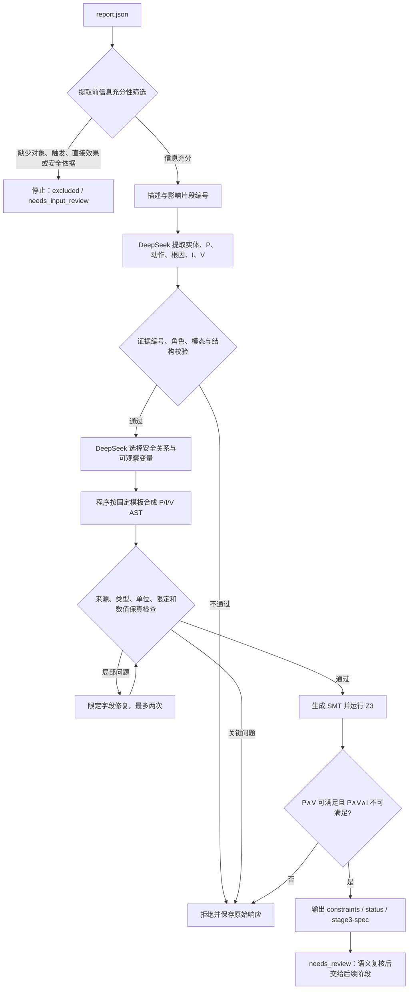

# 阶段二阶段性成果汇报

日期：2026-09-21

## 一、研究目标

阶段二面向智能合约漏洞报告，目标是：

1. 从报告自然语言中提取场景前提 P、报告声称的安全性质 I，以及直接违反该性质的效果 V；
2. 将 P/I/V 转换为带原文证据、变量类型、单位和作用域的形式化约束；
3. 输出可供后续代码验证使用的 SMT 和标准接口，但不在本阶段判断 PoC 是否真的执行出 V。

阶段二独立于阶段一运行。阶段一的代码切片结果不是本阶段提取 P/I/V 的必要输入；二者在
后续验证阶段通过变量和行为绑定汇合。

## 二、当前工作流

## 三、已完成的核心工作

- 建立了 `report.json → 证据编号 → P/I/V → 形式计划 → SMT/Z3 → stage3-spec` 的完整工程链。
- 模型只返回证据编号，程序取回原文，未知编号直接拒绝，减少伪造引文。
- 建立 12 类通用安全关系：权限、值关系、边界、单调、守恒、比例公平、状态对应、时序、
  顺序、数据结构、进度和容量范围。
- v3.17 为主要关系提供专用确定性模板，并新增三项通用门：impact 强限定保留、P 来源独立
  绑定、协议编号不作为数值常量。
- 支持类型、单位、地址、数值、未决项、直接 I/V 关系和 Z3 正反例检查。
- 所有模型调用与重试均保留原始响应、用量和失败原因；候选可离线重放。
- 阶段一和阶段三代码未被修改。

## 四、当前实验结果

| 实验 | 工程结果 | 语义结果 | 结论 |
| --- | --- | --- | --- |
| v3.16 冻结留出集（5 份） | 3/5 候选 | 严格公式 1/3 | 固定模板改善稳定性，但攻击限定仍会遗漏 |
| v3.17 开发回归（5 份） | 2/5 候选；2/2 可重放 | 1 份较完整、1 份部分正确 | 新限定门有效，但修复收敛和派生定义仍是瓶颈 |
| 本地自动回归 | 300/300 | 清理退役分支后的主线基线；仅证明实现一致 | 不等于自然语言语义准确率 |

v3.17 开发回归调用 DeepSeek 11 次，共 78,886 tokens，模型响应耗时合计 95.778 秒。详细
结果见 [开发回归报告](../evaluation/archive/prompt_v317_development_03/REPORT.md)。

## 五、当前能力边界

目前系统可以：

- 对信息充分的报告生成可审计的 P/I/V 候选；
- 拒绝未知证据、错误来源、类型/单位冲突和部分数值失真；
- 判断 V 是否在生成公式中直接否定 I；
- 生成 SMT、Z3 反例和阶段三接口。

目前系统不能：

- 仅凭 Z3 证明模型正确理解了报告；
- 证明 PoC 真实执行出报告声称的效果；
- 给出可信的总体准确率，因为尚无覆盖多类漏洞、经独立确认的金标准；
- 对所有跨交易、复杂经济价值、量词和长期时序性质稳定形式化。

因此当前定位是**研究原型和带人工复核的候选生成器**，不是可无人值守使用的真实性判定器。

## 六、主要技术瓶颈

1. 形式化成功率低于要素提取成功率，主要错误发生在“语义要素到公式”的映射阶段。
2. 局部修复容易只改表面字段，没有同步修正变量来源或相关定义。
3. 派生变量目前可能通过蕴含进入 I，存在定义为假时性质空真的风险。
4. P 仍可能混入漏洞结果；来源合法并不自动保证它是动作前条件。
5. 安全关系类别仍可能错位，影响模板选择和公式可解释性。
6. 当前样本规模小且多为开发案例，不能把开发集比例报告为泛化准确率。

## 七、下一步计划

近期优先建立新版本 v3.18，不改写 v3.17 历史结果：

1. 将派生定义提升为显式公理，消除 I 的空真；
2. 联动修复谓词、符号来源和派生表达式，明确 action/root-cause 的证据规则；
3. 增加 P 时序角色检查和“选中 impact—关系模板”一致性检查；
4. 使用当前五例做开发回归，确认缺陷被修复；
5. 冻结 Prompt 与程序规则，再用全新报告测工程完成率、核心语义正确率、误放行率和误拒绝率。

阶段性结论：阶段二的基本链路已经建立并可审计，当前研究重点已经从“能否生成公式”转为
“如何确保公式忠于报告且不过度误拒绝”。
